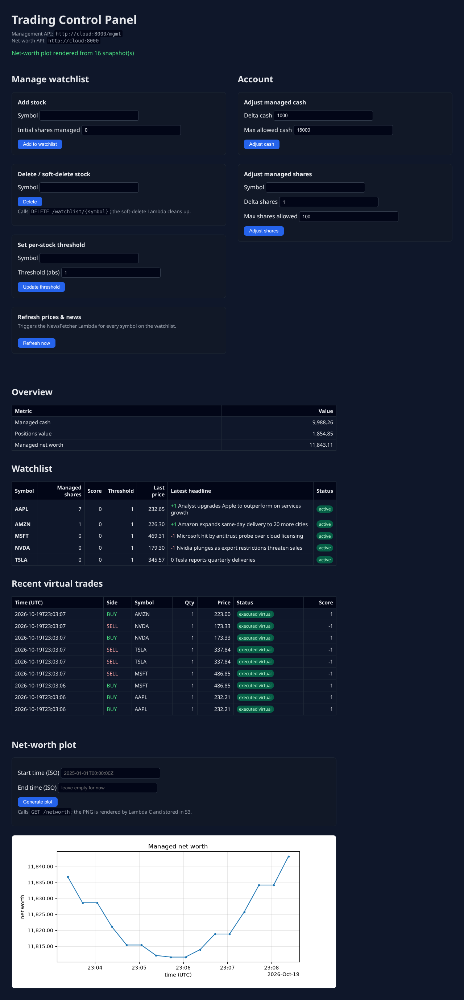
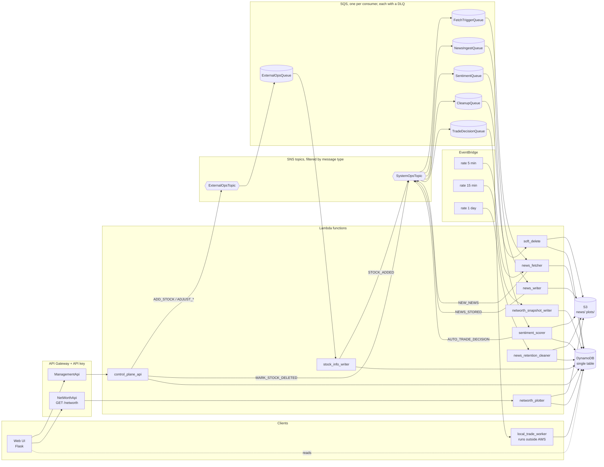

# cloud-stock-operator

A serverless, event-driven watchlist and **paper-trading** system on AWS, defined with the AWS CDK (Python): news for the stocks you follow is fetched, scored for sentiment, and turned into virtual BUY/SELL decisions through SNS/SQS fan-out, nine Lambda functions and a single DynamoDB table. The whole pipeline also runs locally in Docker, with no AWS account.

[](https://github.com/Ctwqk/cloud-stock-operator/actions/workflows/ci.yml)



*The local demo after seeding: five stocks, scored headlines, executed virtual trades and the net-worth chart rendered by the plotter Lambda. News and prices in the demo are canned fixtures (see [Local demo](#local-demo)).*

## What it does

1. You add stocks to a watchlist (web UI or HTTP API) and give the account some managed cash.
2. A scheduled **news fetcher** pulls prices and headlines (yfinance) for every watched symbol and publishes each unseen item as a `NEW_NEWS` message.
3. A **news writer** stores the article in S3; a **sentiment scorer** scores it with VADER plus a finance lexicon and adds +1 / 0 / -1 to the stock's running score.
4. When a stock's score reaches its threshold, an `AUTO_TRADE_DECISION` is published. A **trade worker** (which runs *outside* AWS) executes it as a virtual trade at the last fetched price, against the managed cash and shares.
5. A scheduled **snapshot writer** records the managed net worth every 15 minutes; a **plotter** Lambda renders the series to a PNG.

No broker is involved: trades are simulated, and nothing here is investment advice.

## Architecture



Three stacks: `DataStack` (table, bucket), `MessagingStack` (topics, queues, DLQs, subscriptions) and `AppStack` (functions, event sources, schedules, APIs).

### One queue per consumer

Every message carries a `type` field that is also set as an SNS message attribute. Each queue subscribes with a filter policy on that attribute, so a message type lands in exactly one queue and a consumer never sees (or silently deletes) a message that is not for it. The routing table lives in [`lambda/common/topology.py`](lambda/common/topology.py); the CDK stack **and** the local runtime are generated from it, and a test publishes every message type and checks where it lands.

### Message types

| Type | Topic -> queue | Producer | Consumer |
|---|---|---|---|
| `ADD_STOCK` | ExternalOps -> ExternalOpsQueue | control plane | `stock_info_writer` |
| `ADJUST_MANAGED_CASH` | ExternalOps -> ExternalOpsQueue | control plane | `stock_info_writer` |
| `ADJUST_MANAGED_SHARES` | ExternalOps -> ExternalOpsQueue | control plane | `stock_info_writer` |
| `STOCK_ADDED` | SystemOps -> FetchTriggerQueue | `stock_info_writer` | `news_fetcher` (fetch the new symbol now) |
| `NEW_NEWS` | SystemOps -> NewsIngestQueue | `news_fetcher` | `news_writer` |
| `NEWS_STORED` | SystemOps -> SentimentQueue | `news_writer` | `sentiment_scorer` |
| `AUTO_TRADE_DECISION` | SystemOps -> TradeDecisionQueue | `sentiment_scorer`, `POST /sentiment` | `local_trade_worker` |
| `MARK_STOCK_DELETED`, `CLEANUP_STOCK` | SystemOps -> CleanupQueue | control plane | `soft_delete` |

### Single-table key design

All items of one tenant share a partition: `PK = ACCOUNT#<account_id>` (the AWS account id). The sort key prefix says what the item is. Timestamps are fixed-width UTC (`2025-12-01T09:30:00.000000Z`) so `begins_with` / `BETWEEN` queries are chronological.

| `SK` | Item | Written by |
|---|---|---|
| `SUMMARY` | managed cash, positions value, net worth | `stock_info_writer`, trade worker, snapshot writer |
| `STOCK#<SYMBOL>` | watchlist entry: shares, score, threshold, last price/headline, `is_deleted` | D, fetcher, scorer, control plane |
| `NETWORTH#<ts>` | net-worth snapshot (time series) | `networth_snapshot_writer` |
| `TRADE#<ts>#<decision_id>` | virtual trade log, including `REJECTED_*` | trade worker |
| `SCORE#<SYMBOL>#<ts>` | sentiment history per stock | scorer |
| `NEWSHASH#<SYMBOL>#<hash>` | "news already seen" marker, TTL | fetcher |
| `SCORED#<news_id>` | scoring result and immutable decision payload for delivery retries, TTL | scoring |
| `OP#<op_id>` | outcome of an asynchronous command (`APPLIED`/`REJECTED`), TTL | `stock_info_writer`, `soft_delete` |
| `DECISION#<decision_id>` | "trade already executed" marker, TTL | trade worker |

The table has TTL enabled on the `ttl` attribute. S3 keys: `news/<SYMBOL>/<yyyy-mm-dd>/<news_id>.json` and `plots/networth/<account>/<uuid>.png`.

## Tech stack

Python 3.12, AWS CDK v2 (Python), Lambda, API Gateway (REST), SNS, SQS, DynamoDB, S3, EventBridge, CloudWatch Logs; VADER sentiment, yfinance, matplotlib; Flask for the demo UI; pytest + moto for tests; ruff; uv; GitHub Actions; Docker Compose.

## Quickstart

Prerequisites: [uv](https://docs.astral.sh/uv/), Node.js 22 (CDK tests and `cdk synth`), Docker (local demo).

```bash
make install        # uv sync: locked Python 3.12 environment
make test           # handlers on moto, CDK assertions, end-to-end pipeline
make lint           # ruff check + format check
make synth          # cdk synth, offline, no AWS credentials
```

### Local demo

```bash
make demo                      # docker compose -f local_app/docker-compose.yml up --build
# open http://localhost:9090   (WEB_PORT=41090 make demo to use another port)
make demo-down
```

Four containers from one image: `cloud` (the [moto](https://docs.getmoto.org) server standing in for DynamoDB/S3/SNS/SQS/STS, the *real* Lambda handlers driven by queue pollers and timers, and an API Gateway stand-in that enforces an API key), `seed` (adds $10,000 managed cash and five stocks through the public API, then exits), `worker` (the trade worker polling `TradeDecisionQueue`) and `web`.

What is real and what is canned in the demo:

* real: every Lambda handler, the SNS filter routing, the queues and DLQs, idempotency, sentiment scoring, the trade engine, the plotter;
* canned: news and prices come from [`local_app/fixtures/market.json`](local_app/fixtures/market.json) (`NEWS_PROVIDER=fixture`), and prices follow a small deterministic +/-2 % sine (`NEWS_FIXTURE_DRIFT=1`) so the chart is not a flat line. Nothing in the screenshot is market data.

`make smoke` (also run in CI) starts the demo, waits until trades appear in the UI and tears it down. To try the real yfinance provider, run the fetcher with `NEWS_PROVIDER=yfinance` and the layer built by `make layers`.

To reproduce the screenshot with Playwright (Node.js required):

```bash
npx --yes playwright@1.57.0 install chromium  # skip if this browser is already cached
CAPTURE_SCREENSHOT=1 WEB_PORT=41090 make smoke
```

This waits for virtual trades and at least three scheduled snapshots, generates the plot through the UI, writes `docs/screenshot.png`, and stops the stack. `CHROMIUM_PATH` can select an existing Chromium executable. The demo binds to localhost; each service has a memory and process limit.

For development without Docker, `PYTHONPATH=lambda:local_app uv run python local_app/local_cloud.py` starts the emulator on `:5000`/`:8000`. The web UI, seed and worker are separate scripts; configure their environment from `docker-compose.yml`, replacing the `cloud` hostname with `127.0.0.1`. The [environment example](local_app/.env.example) describes connections to a deployed AWS stack.

### Deploying to AWS (documented, not executed in this repo's CI)

```bash
make install && make layers                  # layers: yfinance, matplotlib, VADER (Linux x86_64 wheels)
cd cdk
export CDK_DEFAULT_ACCOUNT=<account-id> CDK_DEFAULT_REGION=<region>
uv run --project .. -- npx aws-cdk@2 bootstrap                       # once per account/region
uv run --project .. -- npx aws-cdk@2 deploy --all                    # optional: -c fetch_interval_minutes=15 -c retain_data=true
cd ..                                                              # return to the repository root
```

`cdk synth` works without the layers (it substitutes empty placeholders and prints a warning); a deploy needs them. Afterwards run the UI and the trade worker from the repository root: `AWS_REGION=<region> ./local_app/run_against_aws.sh` (reads the CloudFormation outputs, fetches the API key value, starts `docker-compose.aws.yml`). The launcher requires the AWS CLI and a configured, container-readable `~/.aws` profile (select with `AWS_PROFILE`); environment-only credentials are not forwarded to these containers. To remove the stacks from the repository root, use `cd cdk && uv run --project .. -- npx aws-cdk@2 destroy --all`; data is retained if `retain_data=true` was set at deployment.

The APIs require an API key (usage plan: 10 req/s, burst 20). That is a shared secret, not user authentication.

## Project layout

```
cdk/                  CDK app: app.py, infra_stack.py (DataStack, MessagingStack, AppStack)
lambda/
  common/             shared package (keys, messaging, topology, sentiment, scoring, retention)
  news_fetcher/       A  schedule + STOCK_ADDED -> NEW_NEWS      (providers.py: yfinance / fixture)
  news_writer/        F  NEW_NEWS -> S3 -> NEWS_STORED
  sentiment_scorer/   B  NEWS_STORED -> score -> AUTO_TRADE_DECISION
  stock_info_writer/  D  ADD_STOCK / ADJUST_* commands (exactly-once effect)
  soft_delete/        E  MARK_STOCK_DELETED / CLEANUP_STOCK
  news_retention_cleaner/ networth_snapshot_writer/ networth_plotter/ control_plane_api/
local_app/            local demo: local_cloud.py (emulator), web_app.py, local_trade_worker.py,
                      demo_seed.py, fixtures/, Dockerfile, docker-compose*.yml
layers/               pip requirements for the Lambda layers (built into layers/build/, git-ignored)
scripts/              build_layers.sh, smoke_local_demo.sh, capture_screenshot.js
tests/                lambdas/ (per-handler, moto) · local/ (worker, runtime, web, e2e) · cdk/ (assertions)
```

Each Lambda is packaged from `lambda/`: its own package plus `common/` (the CDK stack excludes the other functions, and a test checks it).

## Tests

`make test` runs the suite (coverage ~91 %):

* every Lambda handler against moto (DynamoDB, S3, SNS, SQS, STS) with realistic event shapes (SNS-in-SQS envelope, API Gateway proxy, EventBridge scheduled event, yfinance payloads) kept under `tests/fixtures/`;
* regression tests for each bug listed below;
* CDK assertion tests on the synthesized templates (DLQ + redrive on every queue, one filter policy per queue, `ReportBatchItemFailures`, API keys, exact DynamoDB operations per handler, S3 object and listing prefixes, no wildcard actions in application policies, queue visibility >= 6x function timeout, asset contents) and a test that runs the whole pipeline with each Lambda seeing **only** the environment variables CDK declares for it;
* end-to-end tests: API call -> SNS/SQS -> fetcher -> writer -> scorer -> decision -> trade worker -> net worth, plus the web UI over real HTTP with background poller threads.

CI ([`.github/workflows/ci.yml`](.github/workflows/ci.yml)): ruff lint and format check; pytest with a coverage gate; `cdk synth` with the CLI; layer build and size check; the docker compose smoke test.

See the [verification record](docs/verification.md) for commands, measured coverage, offline synthesis and screenshot evidence.

## Design notes and trade-offs

* **At-least-once delivery is assumed everywhere.** Commands carry an `op_id`; the state change and an `OP#` marker are written in one DynamoDB transaction. News ids are content hashes (deterministic S3 key, `SCORED#` marker). Trade decisions carry a deterministic `decision_id`, and the worker executes cash, shares, trade log and a `DECISION#` marker in a single transaction. Handlers return per-message failures (`ReportBatchItemFailures`), so one bad message is retried and eventually dead-lettered without replaying the batch.
* **Balance commands go through the queue.** Add-stock, cash and share deltas are validated by the API, applied by `stock_info_writer` with optimistic concurrency, and answered with `202` + `GET /operations/{id}`. Threshold settings and externally supplied sentiment stay synchronous. Sentiment is a delta: `POST /sentiment` requires a nonempty string `event_id`, unique within the account and reused on retries.
* **Deletion precedes cleanup.** The deleted flag and an operation marker are committed together before touching S3, so cleanup failures leave the stock ineligible for trades and still retry through SQS/DLQ. A redelivered delete cannot deactivate a subsequently re-added stock. `deleted_news_count` counts a completed cleanup pass once; it can undercount work done before a partial failure or by the daily cleaner.
* **A decision consumes the score atomically.** The score resets to 0, `decision_count` advances, and the immutable decision payload is saved on the `SCORED#` marker in one transaction. A failed or ambiguous SNS publish replays that payload on redelivery, even after other headlines arrive. Optimistic conditions protect the score, threshold and decision counter from concurrent changes. The worker requires a stable decision ID and a positive whole-number quantity.
* **Sentiment is a lexicon, on purpose.** VADER plus ~100 finance terms is deterministic, tiny (fits a layer, no model download) and testable. It sits behind `SentimentScorer`; a model-backed scorer can be added to `BACKENDS`. It looks at one headline and summary at a time and misses context and sarcasm.
* **The local runtime reuses the production wiring.** `local_cloud.py` builds queues and filter subscriptions from the same `topology.py` as the CDK stack and calls the real handlers, so the demo exercises the deployed routing rather than a re-implementation. moto is not AWS, though: see below.
* **Trade-off, news retention:** news of active stocks is never expired; only soft-deleted stocks are cleaned (tag after 3 weeks, delete after 6).

### Bugs fixed relative to the original code

* Three consumers competed for one queue, and Lambdas that ignored a message still deleted it: messages were lost. The sentiment scorer was never triggered at all.
* Cash/share adjustments used a DynamoDB condition expression with arithmetic (DynamoDB conditions have none; the original code's own comments say so) with errors swallowed, and the API *also* wrote the change itself, so an adjustment that did apply was applied twice. `ADD_STOCK` reset score and threshold; several `update_item` calls created phantom items.
* Sentiment was `random.choice`; the score was never reset after a decision; news was marked "seen" before it was published (a failed publish lost it); S3 keys used `uuid4` (duplicates on redelivery); net worth used a stale `positions_value`; sort keys mixed `Z` and `+00:00` timestamps; Lambda asset paths depended on the working directory and referenced layer zips that were not in the repo (so `cdk synth` failed on a clean checkout).

## Known limitations and roadmap

* **Not deployed or verified on real AWS** (no credentials were available): correctness rests on moto, CDK assertions and `cdk synth`. Real IAM enforcement, API Gateway behaviour, TTL expiry, service-side transaction conflicts, and SNS/SQS delivery timing remain untested. Local pollers implement partial-batch acknowledgement; moto does not run AWS Lambda event source mappings or asynchronous invocation retries.
* Live yfinance is not exercised in CI or the deterministic demo. Provider tests use recorded payloads, including the `Ticker.news` / `yf.Search` fallback. yfinance is an unofficial API and can break.
* Single tenant: the account id is the AWS account id, and S3 news keys are not account-scoped (a soft delete affects every account's news for that symbol).
* The API key is a shared secret; there is no per-user auth. No CloudWatch alarms on the DLQs.
* Standard SQS queues can deliver commands and decisions out of order; wait for a dependent command's applied state before issuing the next one. Deduplication is bounded by marker retention (30 days for commands, 45 days for scoring/trades); replay failed deliveries from the DLQ before those markers expire. Cached summary valuations are eventually consistent with concurrent trades and price changes.
* The retention cleaner scans the table once a day; fine at this size, not at scale.
* Roadmap ideas: alarms on DLQ depth, Cognito/IAM auth, a model-backed scorer behind the same interface, account-scoped S3 keys, a read API so the UI does not need DynamoDB credentials.

### Cost

Everything is pay-per-use (DynamoDB on-demand, Lambda, SQS, SNS, S3, API Gateway, CloudWatch Logs with 30-day retention); there are no always-on instances. I have not deployed it, so there is no measured bill. Things to watch: the 5-minute fetch schedule (configurable with `-c fetch_interval_minutes`), the five SQS event source mappings that poll continuously, API Gateway requests, and the yfinance (~143 MB) and matplotlib (~126 MB) layers.

## License

No license file has been chosen yet; all rights reserved by default until the owner adds one.
